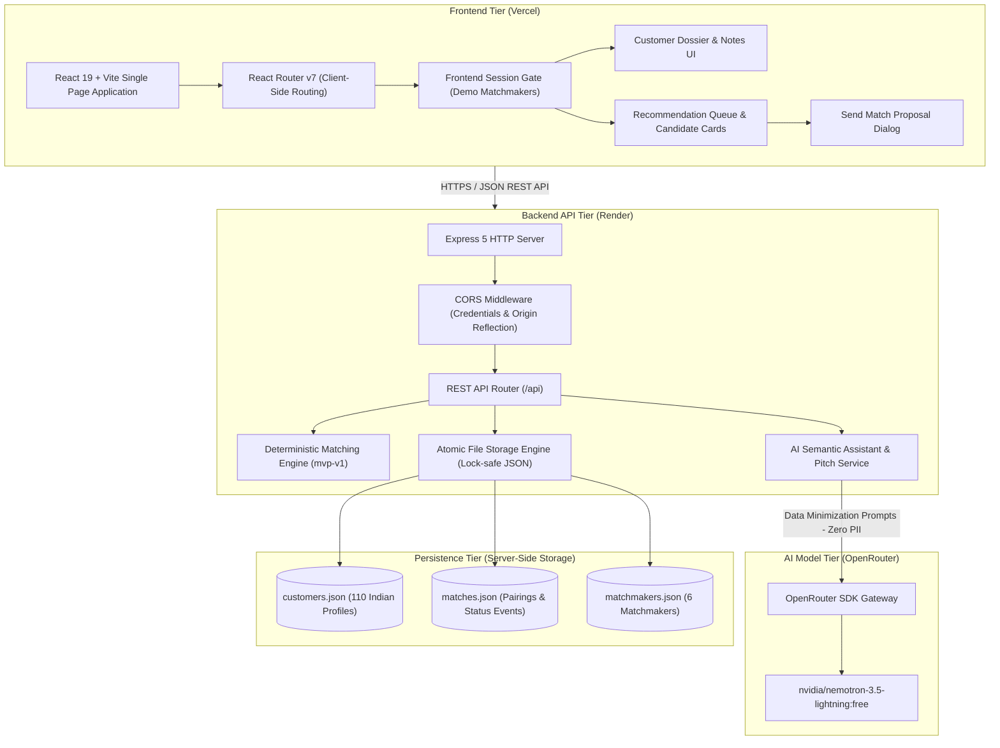
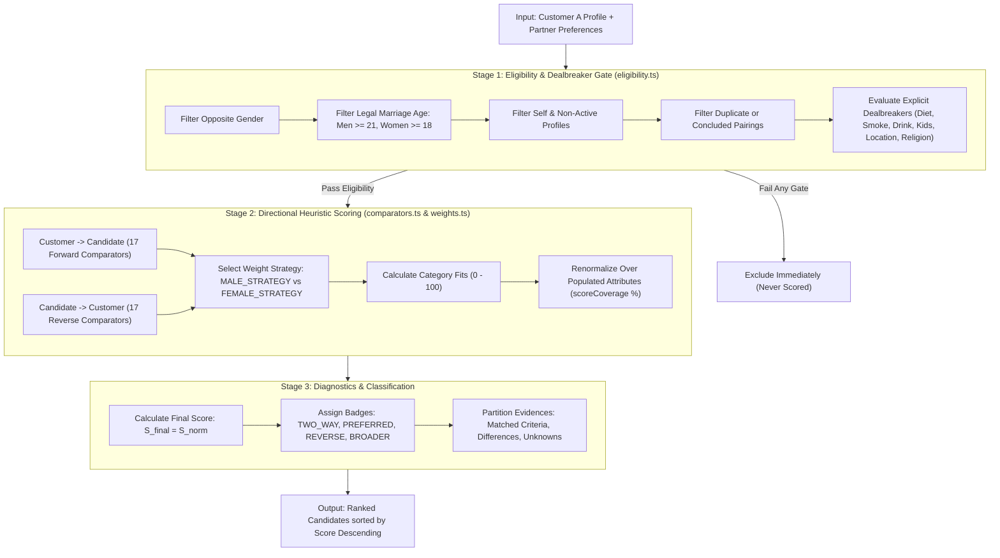
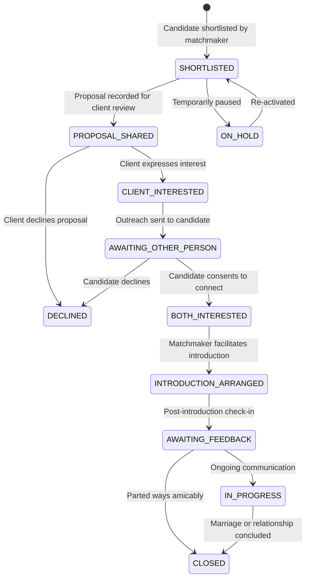

# The Date Crew — Technical Architecture Document

This document details the system design, data contracts, deterministic matching engine, AI co-pilot pipeline, and deployment topology of **The Date Crew (TDC) Matchmaker Dashboard**.

---

## 1. High-Level System Architecture

The application is architected as a decoupled, dual-tier web system with privacy-preserving external AI integration and atomic server-side JSON persistence.



---

## 2. Frontend Architecture (React 19 + Vite)

### Component Hierarchy
```text
client/src/
├── app/
│   └── App.tsx                   # Top-level provider, session state, toast context
├── components/
│   ├── layout/
│   │   ├── AppShell.tsx          # Responsive navigation shell with mobile drawer
│   │   ├── Header.tsx            # Matchmaker profile, notification bell, sign out
│   │   └── Sidebar.tsx           # Dashboard & Customer portfolio links
│   └── ui/                       # Accessible UI primitives (Button, Dialog, Badge, Input)
├── features/
│   ├── auth/
│   │   ├── LoginPage.tsx         # Demo login gate
│   │   └── demo-credentials.ts  # Hardcoded credentials for local demonstration
│   ├── customers/
│   │   ├── CustomersPage.tsx     # Portfolio table with instant search and filters
│   │   └── CustomerDetailPage.tsx# Comprehensive client dossier & private notes
│   ├── dashboard/
│   │   └── DashboardPage.tsx     # Matchmaker KPIs, quick actions, operational queues
│   └── matching/
│       ├── MatchingRecommendationsView.tsx # Ranked recommendations list (<25ms load)
│       ├── CandidateCard.tsx     # Structured evidence cards & on-demand AI button
│       └── SendMatchDialog.tsx   # Proposal dialog with AI introduction pitch generator
├── lib/
│   ├── api.ts                    # Typed client API client targeting VITE_API_BASE_URL
│   └── utils.ts                  # Tailwind class merging (clsx + twMerge)
└── index.css                     # Tailwind CSS v4 design tokens (HSL palette)
```

### Key Frontend Architectural Decisions
1. **Zero Client-Side Lag:** Initial candidate matching computes entirely on the backend in under 25ms. The UI renders immediately without blocking spinners.
2. **Accessible Dialog Primitives:** Built with `@radix-ui/react-dialog` with proper ARIA attributes, focus trapping, and `Escape` key handlers.
3. **Responsive Mobile Shell:** Adapts fluidly between desktop sidebar navigation and an accessible mobile backdrop drawer.
4. **Tailored Design System:** Bespoke HSL color tokens (`bg-canvas`, `bg-surface`, `text-ink`, `primary`, `warning-soft`) designed for clarity, warmth, and high readability.

---

## 3. Backend Architecture (Node.js + Express 5)

### Module Structure
```text
server/src/
├── app.ts                        # Express application instance, CORS, static fallbacks
├── index.ts                      # Server bootstrap, port binding (0.0.0.0)
├── routes/
│   └── api.ts                    # Express route controllers & centralized error handling
├── engine/
│   ├── matching-engine.ts        # Pure deterministic matching orchestrator
│   ├── eligibility.ts            # Stage 1: Eligibility & hard dealbreaker gates
│   ├── comparators.ts            # Stage 2: 17 scalar, range, and multi-select comparators
│   ├── weights.ts                # Gender-specific weight vectors (MALE vs FEMALE)
│   └── semantic-assistant.ts     # OpenRouter SDK integration & AI prompt pipeline
├── repositories/
│   ├── customer-repository.ts    # Customer queries, dossier mutations, private notes
│   ├── match-repository.ts       # Pairing lifecycle, status transitions, follow-up dates
│   └── storage.ts                # Atomic JSON file reader/writer with file locks
└── data/
    ├── customers.json            # 110 synthetically generated Indian client records
    ├── matches.json              # Active and historical pairing records
    └── matchmakers.json          # Matchmaker directory
```

### REST API Specifications

| Method | Endpoint | Description |
|---|---|---|
| `GET` | `/api/health` | Health check endpoint returning `{ status: "ok" }` |
| `GET` | `/api/customers` | List customer summaries with filtering (`gender`, `readiness`, `search`) |
| `GET` | `/api/customers/:id` | Retrieve complete customer dossier (profile + partner preferences) |
| `POST` | `/api/customers/:id/notes` | Add a customer-level matchmaker note |
| `GET` | `/api/customers/:id/recommendations` | Compute instantaneous deterministic match recommendations |
| `POST` | `/api/customers/:id/candidates/:candidateId/ai-analyze` | On-demand single candidate AI semantic synergy evaluation |
| `POST` | `/api/customers/:id/candidates/:candidateId/ai-pitch` | On-demand AI introduction pitch generator for client review |
| `GET` | `/api/customers/:id/matches` | Get pairing history and current stages for a customer |
| `POST` | `/api/matches` | Create a new match pairing between two customers |
| `GET` | `/api/matches/:id` | Get individual pairing record |
| `PATCH` | `/api/matches/:id/status` | Advance pairing status with transition validation |
| `POST` | `/api/matches/:id/notes` | Add pairing-specific matchmaker progress note |
| `PATCH` | `/api/matches/:id/follow-up` | Schedule or update follow-up date |
| `POST` | `/api/matches/:id/share-proposal` | Record mock proposal sharing (`PROPOSAL_SHARED`) |

---

## 4. Deterministic Matching Engine Specification (`mvp-v1`)

The matching algorithm is completely deterministic, explainable, and decoupled from HTTP route handlers.



### Mathematical Scoring Formulation

For any eligible customer $A$ and candidate $B$:

1. **Directional Comparison Score:**
   Each of the 17 criteria produces a comparison value:
   $$\text{score}(c) = \begin{cases} 1.0 & \text{if MATCH} \\ 0.7 & \text{if PARTIAL\_MATCH} \\ 0.0 & \text{if NO\_MATCH} \\ \text{null} & \text{if UNKNOWN or NOT\_APPLICABLE} \end{cases}$$

2. **Category Fit Calculation:**
   For any category containing $N_{\text{usable}}$ criteria where $\text{score}(c) \neq \text{null}$:
   $$\text{Fit}_{\text{cat}} = \left( \frac{1}{N_{\text{usable}}} \sum_{i=1}^{N_{\text{usable}}} \text{score}(c_i) \right) \times 100$$
   If $N_{\text{usable}} = 0$, $\text{Fit}_{\text{cat}} = \text{null}$ (category is marked unknown).

3. **Weight Renormalization:**
   Let $W_{\text{cat}}$ be the configured weight of a category, and $K$ be the set of categories where $\text{Fit}_{\text{cat}} \neq \text{null}$:
   $$\text{scoreCoverage} = \sum_{\text{cat} \in K} W_{\text{cat}}$$
   $$\text{Final Compatibility Score} = \frac{\sum_{\text{cat} \in K} \left( \text{Fit}_{\text{cat}} \times W_{\text{cat}} \right)}{\text{scoreCoverage}}$$

### Gender-Differentiated Weight Vectors

To reflect documented patterns in Indian matchmaking without penalizing candidates with unstated preferences:

| Category | Male Strategy Weight | Female Strategy Weight | Comparison Basis |
|---|---:|---:|---|
| **Forward Customer Preference Fit** | 30% | 30% | General customer preference satisfaction |
| **Reverse Candidate Preference Fit** | 10% | 10% | Candidate reverse preference satisfaction |
| **Relationship & Family Planning** | 20% | 20% | Relationship goal, children stance & timeline |
| **Age Alignment** | 8% | — | Younger age preference (male strategy) |
| **Income Alignment** | 7% | — | Lower income alignment (male strategy) |
| **Height Alignment** | 5% | — | Shorter height alignment (male strategy) |
| **Career & Education Alignment** | 5% | 12% | Designation, company, profession category |
| **Education Tier** | — | 5% | Highest educational degree alignment |
| **Core Values & Priorities** | 10% | 10% | Multi-select core value alignment |
| **Location & Relocation** | — | 8% | City, state, and willingness to relocate |
| **Lifestyle & Interests** | 5% | 5% | Diet, drinking, smoking, hobbies & pets |
| **Total Weight** | **100%** | **100%** | Dedicated categories excluded from general fit |

---

## 5. Privacy-Preserving AI Architecture

```mermaid
flowchart LR
    Raw["Raw Candidate & Customer Records"] --> Sanitize["Data Minimization Pipeline"]
    
    subgraph Sanitize ["Data Minimization (Strip PII)"]
        direction TB
        S1["Remove Names, Emails, Phone Numbers"]
        S2["Remove Exact Ages & Dates of Birth"]
        S3["Remove Photos & Personal Identifiers"]
        S4["Retain Only Abstract Semantic Fields: Education, Career, Core Values, Hobbies"]
    end

    Sanitize --> Prompt["Strict Context-Rich JSON Prompt"]
    Prompt --> Gateway["OpenRouter API Gateway"]
    Gateway --> Model["nvidia/nemotron-3.5-lightning:free (Temp: 0.1)"]
    Model --> Calibrated["Strict JSON Output: Scores, Explanations, Draft Pitches"]
    Calibrated --> PostProcess["Post-Processor & Score Re-Ranker"]
```



### 1. On-Demand Candidate Semantic Analysis
- **Trigger:** Matchmaker clicks `✨ AI Semantic Analysis` on a specific candidate card.
- **Payload:** Anonymized Education level, Profession category, Core Values, and Hobbies.
- **Output:** Validated JSON assigning 0.0 to 1.0 synergy scores with matchmaker-facing rationale:
  - Career synergy (e.g. Sales $\leftrightarrow$ Business Owner)
  - Education compatibility (e.g. Masters $\leftrightarrow$ Doctorate)
  - Core values resonance (e.g. Family-oriented $\leftrightarrow$ Stability)
  - Leisure pursuit synergy (e.g. Hiking $\leftrightarrow$ Nature Trips)

### 2. AI Introduction Pitch Generator
- **Trigger:** Matchmaker clicks `✨ Draft AI Intro Pitch` inside the Send Match Proposal dialog.
- **Context Synthesis:** Injects client desired preferences (desired relationship goals, core values, career fields, hobbies) alongside candidate background details into a boutique matchmaker prompt.
- **Output:** A warm, empathetic 2–3 sentence introduction note addressing the client directly in a refined matchmaker voice.
- **Safety:** The note is rendered into an editable textarea, ensuring the human matchmaker has full oversight to review, personalize, or adjust the draft before confirming.

---

## 6. Pairing Lifecycle State Machine

Relationship stages belong strictly to individual match records (`MatchRecord`), ensuring that one customer's ongoing dialogue with Candidate A does not overwrite their relationship stage with Candidate B.



---

## 7. Data Models & Contracts (`shared/contracts.ts`)

```typescript
export interface PersonProfile {
  id: string;
  firstName: string;
  lastName: string;
  gender: "MAN" | "WOMAN";
  dateOfBirth: string; // YYYY-MM-DD (Age derived dynamically)
  profilePicture: string | null;
  profileStatus: "INCOMPLETE" | "ACTIVE";
  assignedMatchmakerId: string;
  location: { country: string; state: string; city: string };
  heightCm: number;
  maritalStatus: "NEVER_MARRIED" | "DIVORCED" | "WIDOWED" | "SEPARATED" | "OTHER";
  contact: { email: string; phone: string };
  languagesKnown: string[];
  education: {
    highestEducation: "HIGH_SCHOOL" | "DIPLOMA" | "BACHELORS" | "MASTERS" | "DOCTORATE" | "OTHER";
    undergraduateCollege: string | null;
    degree: string | null;
    additionalQualifications: string[];
  };
  career: {
    employmentStatus: "EMPLOYED" | "SELF_EMPLOYED" | "BUSINESS_OWNER" | "STUDENT" | "UNEMPLOYED" | "HOMEMAKER" | "OTHER";
    company: string | null;
    designation: string | null;
    professionCategory: string;
    industry: string | null;
    annualIncome: number | null;
    currency: "INR";
    careerGoals: string[];
  };
  culturalBackground: { religion: string | null; community: string | null };
  family: { familyStructure: string | null; siblings: number | null; familyResponsibilities: string[] };
  familyPlanning: { hasChildren: string; wantsChildren: string; opennessToPartnerWithChildren: string; preferredTimeline: string | null };
  relocation: { openToRelocate: string; relocationPreferences: string[] };
  lifestyle: { openToPets: string; dietaryPreference: string; smoking: string; drinking: string; hobbiesInterests: string[]; lifestylePreferences: string[] };
  relationship: { relationshipGoal: string; marriageTimeline: string | null; relationshipPriorities: string[]; coreValues: string[]; expectationsAboutMarriedLife: string[]; personalGoals: string[] };
  notes: CustomerNote[];
  createdAt: string;
  updatedAt: string;
}

export interface MatchRecord {
  id: string;
  customerAId: string;
  customerBId: string;
  createdByMatchmakerId: string;
  status: MatchStatus;
  classifications: MatchClassification[];
  compatibilityScore: number;
  customerPreferenceFit: number;
  reversePreferenceFit: number;
  scoreVersion: "mvp-v1";
  proposal?: {
    sharedAt: string;
    sharedByMatchmakerId: string;
    mockMessage: string;
  };
  introduction?: {
    arrangedAt: string | null;
    feedbackFromCustomerA: string | null;
    feedbackFromCustomerB: string | null;
    outcome: string | null;
  };
  followUpAt?: string | null;
  notes: MatchNote[];
  statusHistory: MatchStatusEvent[];
  createdAt: string;
  updatedAt: string;
}
```

---

## 8. Deployment & Infrastructure Topology

- **Frontend Hosting (Vercel):** Single Page Application bundle built with Vite, served over worldwide edge CDN with client-side rewrite rules in `vercel.json`.
- **Backend Hosting (Render):** Dockerized Node.js/Express service running on Render Free Tier with rolling zero-downtime updates and live health monitoring on `/api/health`.
- **CORS Configuration:** Seamless cross-origin reflection allowing preview and production Vercel domains with full credential support.
