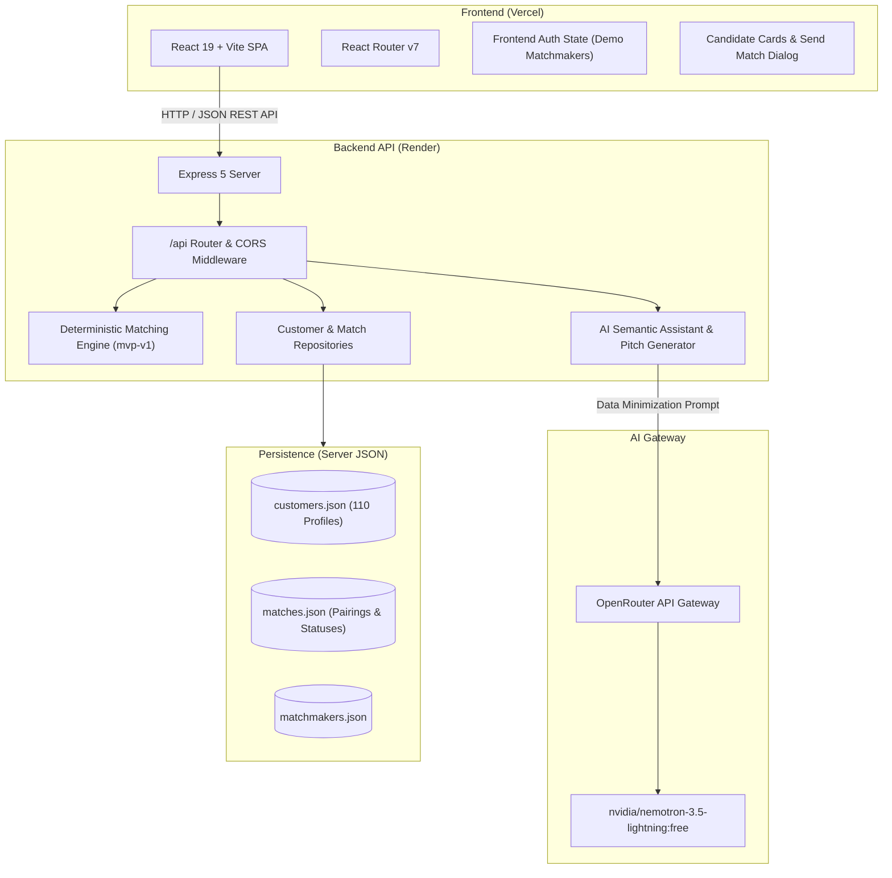
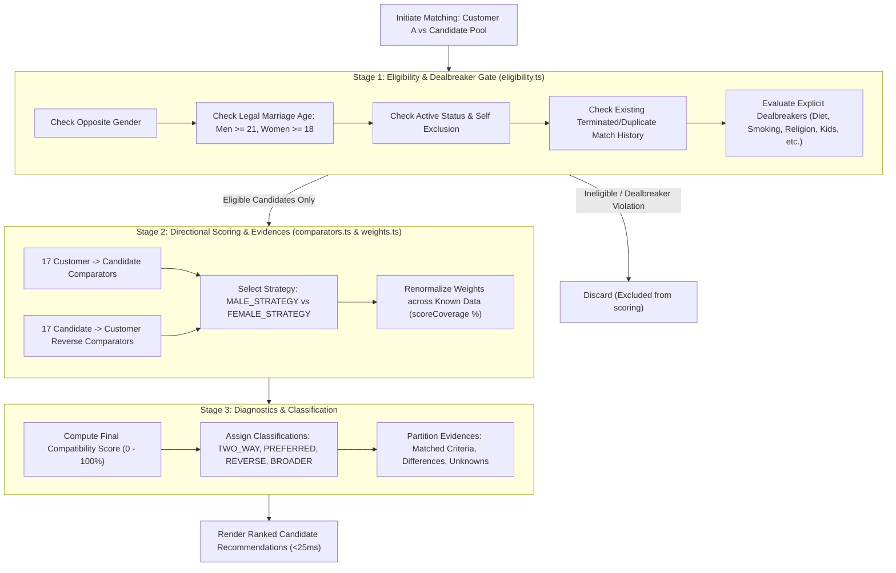
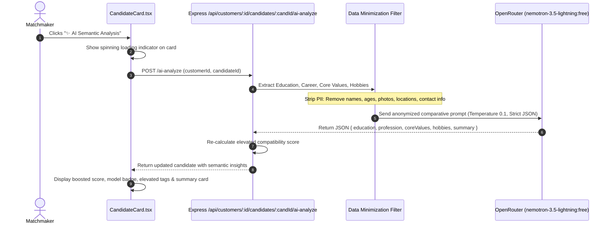
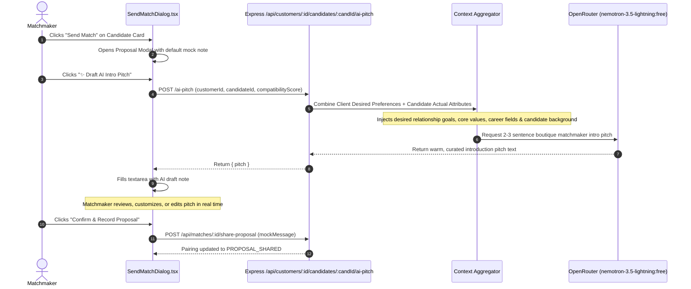
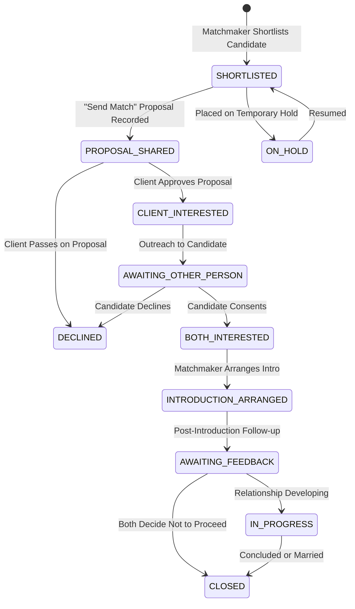

# The Date Crew — Matchmaker Dashboard MVP

An internal, human-first matchmaking operations dashboard built for **The Date Crew (TDC)** to manage client dossiers, evaluate structured candidate compatibility with deterministic scoring, leverage privacy-first AI assistance, and facilitate curated introductions.

---

## 🚀 Live Deployments & Repository
- **Live Frontend (Vercel):** [https://the-date-crew-assignment-livid.vercel.app/](https://the-date-crew-assignment-livid.vercel.app/)
- **Live Backend API (Render):** [https://the-date-crew-assignment-521e.onrender.com](https://the-date-crew-assignment-521e.onrender.com)
- **GitHub Repository:** [https://github.com/Riyanshverma/the-date-crew-assignment](https://github.com/Riyanshverma/the-date-crew-assignment)

---

## 🔑 Demo Login Credentials
All matchmakers use the shared evaluation password `password123`. The gate is frontend-scoped for evaluation and local demonstration purposes:

| Username | Name | Role | Scope |
|---|---|---|---|
| `demo-matchmaker-1` | Aarav Mehta | Matchmaker | Manages assigned client queue |
| `demo-matchmaker-2` | Mira Kapoor | Matchmaker | Manages assigned client queue |
| `demo-matchmaker-3` | Kabir Sharma | Matchmaker | Manages assigned client queue |
| `demo-matchmaker-4` | Ananya Rao | Matchmaker | Manages assigned client queue |
| `demo-matchmaker-5` | Vihaan Sethi | Matchmaker | Manages assigned client queue |
| `demo-matchmaker-6` | Ishita Nair | Matchmaker | Manages assigned client queue |

---

## 📝 2–3 Paragraph Write-Up (Assessment Requirements)

### 1. Technology Choices & Architecture
Selected **React 19 with Vite, TypeScript, and Tailwind CSS** for the frontend, and **Node.js with Express 5 and TypeScript** for the backend, backed by isolated server-side JSON data repositories. React and Vite provide an instantaneous developer feedback loop and snappy, client-side filtering, modal interactions. Express was chosen for its lightweight, unopinionated architecture, which allows us to keep the matching algorithm strictly decoupled as a pure, deterministic TypeScript calculation engine isolated from HTTP route handlers and UI components. Strict TypeScript contracts (`shared/contracts.ts`) ensure end-to-end type safety across both client and server tiers. The interface adheres to modern design principles with tailored HSL tokens, subtle micro-animations, accessible dialogs, and responsive mobile drawers, creating an emotionally resonant boutique tool rather than a generic CRUD application.

### 2. Matching Logic & Domain Modeling
Matching logic was developed through deep research into Indian matrimonial and high-intent relationship platforms (such as **Shaadi.com**, **JeevanSathi**, **Hinge**, and **Bumble**). Unlike modern swipe apps that rely on uncurated algorithmic popularity loops, high-intent matchmaking requires a **multi-tiered, structured evaluation**:
1. **Stage 1 (Eligibility & Hard Dealbreakers):** Candidates are filtered through non-negotiable gates—Indian legal marriage ages (men $\ge 21$, women $\ge 18$), sexual orientation/gender alignment, mutual availability, and explicit dealbreakers (diet, smoking, drinking, marital status, children stance, and location). If a candidate violates a hard dealbreaker, they are immediately excluded; high compatibility in other areas can *never* offset a dealbreaker.
2. **Stage 2 (Bidirectional Directional Scoring):** Both Customer $\rightarrow$ Candidate (Forward Fit) and Candidate $\rightarrow$ Customer (Reverse Fit) are independently scored across 17 distinct criteria. Dedicated gender-differentiated weights (`MALE_STRATEGY` vs. `FEMALE_STRATEGY`) reflect documented Indian relationship dynamics—calibrating higher weights on professional trajectory, education, and family alignment for female clients, and age/income alignment and family planning for male clients—while avoiding double-counting dedicated factors.
3. **Stage 3 (Renormalization & Classification):** Scores are normalized solely over known, populated attributes (`scoreCoverage %`), ensuring candidates with private or unstated fields are not penalized as mismatches. Candidates are classified with transparent badges: `TWO_WAY`, `PREFERRED`, `REVERSE`, or `BROADER`.

### 3. How AI is Used & Ideation Process
AI was leveraged across three distinct stages of development:
- **Ideation & Domain Benchmarking:** In the planning phase, analyzed real-world matrimonial platforms with ChatGPT to model how layered matching filters, reverse preferences, and family values operate in the Indian context. We concluded that Shaadi.com's layered approach—strict qualification gates followed by heuristic preference scoring—best reflected The Date Crew's boutique ethos. ChatGPT was also used to generate rich prompt templates and domain context documents.
- **Agentic Pair-Programming & Implementation:** Utilized **Google Antigravity with Gemini 3.8 Flash** for continuous pair programming, codebase scaffolding, strict typecheck enforcement, component modularization, and automated verification.
- **Runtime Matchmaker AI Tools:** Rather than delegating critical matching decisions to a black-box model, AI is integrated as an on-demand, privacy-preserving co-pilot using OpenRouter's free **`nvidia/nemotron-3.5-lightning:free`**:
  1. **On-Demand Candidate Semantic Analysis:** Matchmakers can click `✨ AI Semantic Analysis` on any candidate card. The backend strips all PII (names, ages, photos, contact details) and transmits only abstract criteria (Education, Career, Core Values, Hobbies) to evaluate nuanced synergy (e.g., recognizing complementary professions like Sales $\leftrightarrow$ Business Owner, or adjacent education tiers like Masters $\leftrightarrow$ Doctorate) to elevate scores with an explainable breakdown.
  2. **AI Introduction Pitch Generator:** Inside the Send Match Proposal dialog, matchmakers can click `✨ Draft AI Intro Pitch`. The LLM synthesizes the client's desired partner preferences with the candidate's actual background into a warm, empathetic 2–3 sentence introduction pitch written from the matchmaker to the client. The note is pre-filled into an editable textarea, keeping the human matchmaker firmly in the loop.

### 4. Key Assumptions Made
- **Privacy by Design:** Zero Personally Identifiable Information (PII) is ever passed to external LLMs; only sanitized attribute pairs are evaluated.
- **Human-in-the-Loop Oversight:** Matchmakers retain final authority on all proposals and pitch notes; AI generates drafts and recommendations, never autonomous actions.
- **Mock Proposal Dispatch:** The "Send Match" action transitions pairing status to `PROPOSAL_SHARED` and records mock review messages locally; no real unsolicited emails or messages are dispatched.
- **Pairing-Specific Statuses:** Relationship statuses (`SHORTLISTED`, `PROPOSAL_SHARED`, `CLIENT_INTERESTED`, etc.) belong to individual match pairs, not the client globally, allowing a client to concurrently evaluate different candidates at distinct stages.

---

## 🏗 High-Level System Architecture



---

## 🧠 Matching Engine Architecture & Pipeline

The matching engine processes the entire opposite-gender candidate pool through a three-stage pipeline:



---

## 🤖 AI Features Data Flow & Sequence Diagrams

### 1. On-Demand Candidate AI Semantic Analysis

Matchmakers can independently trigger deep semantic synergy evaluation for any candidate on demand without slowing down the initial queue load.



### 2. AI Introduction Pitch Generator (Send Match Modal)

When proposing a match to a client, matchmakers can draft a warm, bespoke review note tailored to both the client's partner expectations and the candidate's background.



---

## 🔄 Match Pairing Lifecycle State Machine



---

## 📦 Features List

- **Matchmaker Portal:**
  - Secure demo login with matchmaker-scoped client portfolios.
  - Interactive Customer Directory with instant search, gender filter, and profile readiness filter (`ACTIVE`, `INCOMPLETE`).
- **Comprehensive Client Dossier:**
  - Tabbed overview displaying Personal Details, Cultural Heritage, Career & Education, Family & Relocation, Lifestyle, and Partner Preferences.
  - Private matchmaker notes system with chronological history.
- **Deterministic Matching Engine (`mvp-v1`):**
  - Instantaneous queue computation (`<25ms`) across 110 Indian profiles.
  - Gender-differentiated weighting heuristics (`MALE_STRATEGY` vs `FEMALE_STRATEGY`).
  - Transparent evidence breakdown: **Matched Criteria (Green)**, **Differences (Grey)**, and **Unknown Fields (Yellow)**.
- **AI Co-Pilot Integrations:**
  - On-demand **AI Semantic Relevance Analysis** on individual cards with visual score boost and dimensional explanations.
  - On-demand **AI Introduction Pitch Generator** in the Send Match modal bridging client desires with candidate qualities.
- **Full Human-in-the-Loop Safeguards:**
  - Mandatory demo mock proposal notices.
  - Proposal messages are 100% editable before recording.
- **Production Polish:**
  - Full keyboard accessibility (focus traps, ARIA modals, `Escape` key handlers).
  - Responsive layout with touch-friendly mobile drawer navigation.
  - Zero deployment bloat: Dual-cloud architecture deployed on Vercel and Render.

---

## 💻 Local Development Setup

### Prerequisites
- Node.js $\ge 20$
- npm $\ge 10$

### 1. Clone & Install
```bash
git clone https://github.com/Riyanshverma/the-date-crew-assignment.git
cd the-date-crew-assignment
npm install
```

### 2. Configure Environment Variables
Copy `.env.example` to `.env`:
```bash
cp .env.example .env
```
Add your free OpenRouter API key for live AI features:
```env
PORT=3001
OPENROUTER_API_KEY=your_openrouter_api_key_here
```
*(Note: If `OPENROUTER_API_KEY` is omitted, the system seamlessly operates on deterministic matching and dynamic template fallbacks with zero errors).*

### 3. Run Development Servers
Start both backend API and Vite client concurrently:
```bash
# Terminal 1: Backend API (port 3001)
npm run dev:server

# Terminal 2: Frontend Client (port 5173)
npm run dev:client
```
Visit `http://localhost:5173` to explore the dashboard.

### 4. Build & Typecheck Verification
```bash
npm run typecheck
npm run build
```
